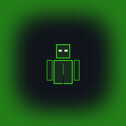

# TargetGlow

<p align="center">
  
  <br>
  <b>Client-side Fabric mod for Minecraft 26.x (26.1 – 26.3)</b><br>
  <i>Smoothly highlights screen edges with a glowing vignette when aiming at targets within melee attack reach.</i>
</p>

<p align="center">
  <a href="https://github.com/PonosDinozavr/TargetGlow/releases"></a>
  <a href="https://github.com/PonosDinozavr/TargetGlow/blob/master/LICENSE"></a>
  
  
</p>

---

## 🇷🇺 Описание (Russian)

**TargetGlow** — легковесный и полностью настраиваемый клиентский Fabric-мод, плавно подсвечивающий края экрана неоновой виньеткой при наведении прицела на цель в пределах дистанции атаки (melee attack reach).

### ✨ Основные возможности:
- 🎯 **Честная дистанция (Melee Attack Reach):** Подсветка срабатывает строго на дистанции удара, куда игрок реально достает ударить рукой или оружием (`client.crosshairPickEntity`).
- 👥 **Поддержка игроков и мобов:** В меню настроек доступен тумблер `Подсветка мобов`:
  - `ВЫКЛ`: подсвечиваются только другие игроки.
  - `ВКЛ`: подсвечиваются как игроки, так и любые живые мобы (`LivingEntity`).
- 🛡️ **Честная игра / Античит (Fair Play):**
  - Если невидимый игрок или моб (`isInvisible()`) **без брони** — подсветка полностью игнорирует цель (не раскрывает невидимок).
  - Если на невидимой цели надета хотя бы одна часть брони — подсветка срабатывает.
  - Стойки для брони (`ArmorStand`), мертвые цели и вид от 3-го лица (F5) не подсвечиваются.
- 🌊 **Плавный рендеринг (Smooth Interpolation):** Плавное появление (Fade-in) и затухание (Fade-out) альфа-канала по времени исключают резкие мерцания.
- 🎨 **Современное меню настроек (Клавиша `G` по умолчанию):**
  - Тумблеры включения мода и подсветки мобов.
  - Ползунок прозрачности (10% - 100%).
  - Скорость затухания (Плавная / Базовая / Быстрая / Мгновенная).
  - RGB-слайдеры тонкой настройки цвета с живым превью и HEX-кодом.
  - 8 стильных пресетов чистых цветов (Лайм, Изумруд, Циан, Синий, Пурпурный, Красный, Золотой, Белый).
  - Поддержка ModMenu и автосохранение в `config/targetglow.json`.
- 🌐 **Двуязычность:**
  - В меню управления (`Controls -> Key Binds`) категория и клавиша всегда отображаются на английском: `TargetGlow` -> `Open TargetGlow Settings`.
  - Весь интерфейс мода автоматически на русском при русской локализации Minecraft, и на английском при любой другой.

---

## 🇬🇧 Description (English)

**TargetGlow** is a lightweight, customizable client-side Fabric mod that smoothly highlights the edges of your screen with a glowing vignette when crosshair aims at an entity within melee attack reach.

### ✨ Key Features:
- 🎯 **Attack Reach Detection:** Highlights only entities within actual strike reach (`client.crosshairPickEntity`).
- 👥 **Target Mobs Toggle:** Configurable setting to target players only or all living mobs.
- 🛡️ **Fair Play & Anti-Cheat Rule:** Completely ignores invisible players/mobs who are not wearing any armor. If wearing at least one armor piece, highlights normally.
- 🌊 **Smooth Fade Transitions:** Time-delta based lerp interpolation eliminates jarring flickering during fast camera movements.
- 🎨 **Customization Menu (`G` key by default):**
  - Opacity slider (10% – 100%).
  - Fade speed options (Smooth / Balanced / Fast / Instant).
  - RGB fine-tuning sliders with real-time swatch preview & HEX code.
  - 8 clean color presets.
  - ModMenu integration & JSON config persistence.

---

## 📦 Поддерживаемые версии (Supported Versions)

| Версия Minecraft | Ветка GitHub (Branch) | Ссылка на скачивание (Download JAR) |
|---|---|---|
| **Minecraft 26.3** | [`26.3`](https://github.com/PonosDinozavr/TargetGlow/tree/26.3) | [`targetglow-26.3-1.0.0.jar`](https://github.com/PonosDinozavr/TargetGlow/releases/download/v1.0.0/targetglow-26.3-1.0.0.jar) |
| **Minecraft 26.2** | [`26.2`](https://github.com/PonosDinozavr/TargetGlow/tree/26.2) | [`targetglow-26.2-1.0.0.jar`](https://github.com/PonosDinozavr/TargetGlow/releases/download/v1.0.0/targetglow-26.2-1.0.0.jar) |
| **Minecraft 26.1.2** | [`26.1.2`](https://github.com/PonosDinozavr/TargetGlow/tree/26.1.2) | [`targetglow-26.1.2-1.0.0.jar`](https://github.com/PonosDinozavr/TargetGlow/releases/download/v1.0.0/targetglow-26.1.2-1.0.0.jar) |
| **Minecraft 26.1.1 (26.11)** | [`26.1.1`](https://github.com/PonosDinozavr/TargetGlow/tree/26.1.1) | [`targetglow-26.1.1-1.0.0.jar`](https://github.com/PonosDinozavr/TargetGlow/releases/download/v1.0.0/targetglow-26.1.1-1.0.0.jar) |
| **Minecraft 26.1** | [`26.1`](https://github.com/PonosDinozavr/TargetGlow/tree/26.1) | [`targetglow-26.1-1.0.0.jar`](https://github.com/PonosDinozavr/TargetGlow/releases/download/v1.0.0/targetglow-26.1-1.0.0.jar) |

---

## 🛠️ Сборка из исходников (Building from Source)

```bash
git clone https://github.com/PonosDinozavr/TargetGlow.git
cd TargetGlow
./gradlew build
```
Готовый `.jar` файл будет в `build/libs/`.

---

## 📜 Автор и лицензия
- Автор: **ponos_dinozavr**
- Лицензия: [MIT License](LICENSE)
